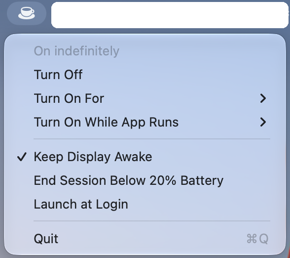

# KeepAwake

A tiny macOS menu bar app that keeps your Mac awake. Around 300 lines of Swift, no dependencies, no telemetry, no network access.



## Features

- **Click** the cup icon to toggle. **Right-click** (or Control-click) for options.
- **Timed sessions**: 15 minutes to 8 hours.
- **While an app runs**: stays awake until the app you pick quits.
- **Keep display awake** or let the screen sleep while the system stays awake.
- **Low battery cutoff** (optional, off by default): ends the session when on battery below 20%.
- **Notifications** when a session ends on its own.
- **Launch at login**, and the session is restored after a restart.

Requires macOS 13 Ventura or later.

## Install

### Download

1. Download `KeepAwake.dmg` from [Releases](../../releases) and drag KeepAwake into Applications.
2. The app isn't notarized by Apple, so the first launch shows *"Apple could not verify 'KeepAwake' is free of malware"*. Click **Done**, then open **System Settings → Privacy & Security** and click **Open Anyway**. You only need to do this once.

### Build from source

Requires Xcode Command Line Tools (`xcode-select --install`).

```bash
git clone https://github.com/sushily1k/KeepAwake.git
cd KeepAwake
./build.sh          # build and install to /Applications
./build.sh --dmg    # or build KeepAwake.dmg
```

Building locally avoids the Gatekeeper prompt.

## How it works

KeepAwake uses the same macOS power assertions as `caffeinate` and Amphetamine (`IOPMAssertionCreateWithName`). Run `pmset -g assertions` to see them while a session is active.

## Compared with Amphetamine

KeepAwake covers the everyday features: toggle, timed sessions, staying awake while an app runs, and a battery cutoff. Amphetamine adds automatic triggers (Wi-Fi, displays, schedules and more), keeping drives awake, and staying awake with the lid closed. If you need those, use Amphetamine.

## License

[MIT](LICENSE)
